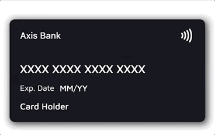
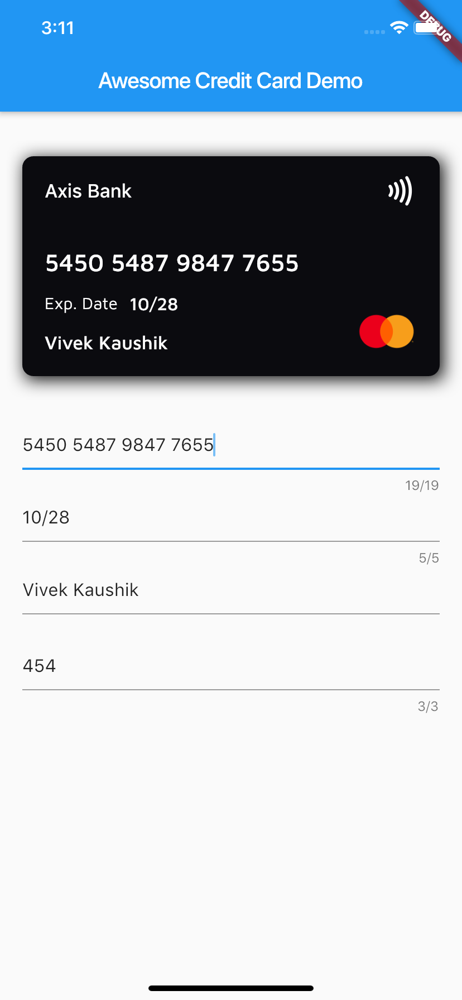
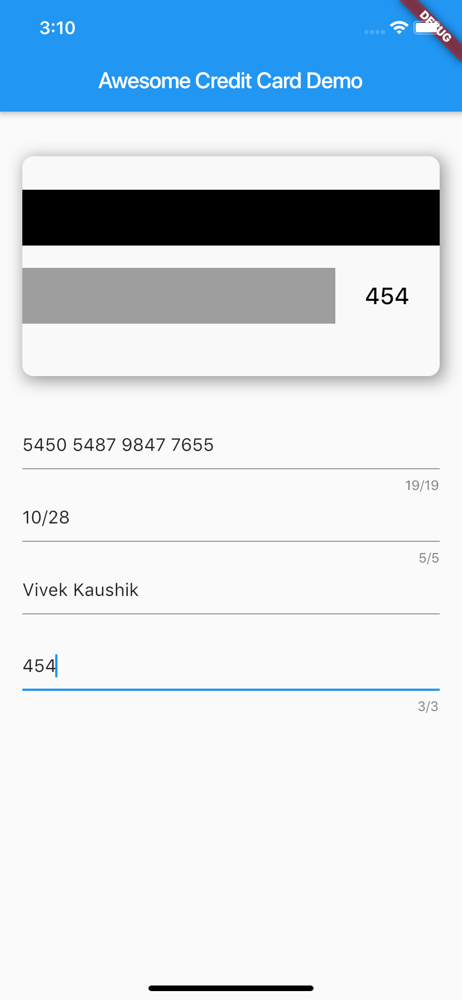

<a href="https://github.com/iamvivekkaushik/AwesomeCard">
</a>

<p><h2 align="left">Awesome Card</h2></p>

<h4>A Flutter package to create a beautiful, animated Credit Card widget in your application.</h4>


___


<p><h6>Stay tuned for the latest updates:</h6>
<a href="https://github.com/iamvivekkaushik" >
</a></p>

</br>

[](https://pub.dev/packages/awesome_card)
[](https://twitter.com/iamvivekkaushik)

## ✨ Features

- 💳 Realistic credit card widget with front and back sides
- 🔄 Smooth 3D flip animation between front and back
- 🔍 Automatic card brand detection from the number (Visa, Mastercard, Amex, RuPay, Elo, Discover, Diners Club, JCB, Maestro)
- 🎭 Automatic number masking per brand (e.g. Amex `XXXX XXXXXX XXXXX`)
- 🎨 Customizable backgrounds, text styles, labels, and fully custom layouts
- 📏 Responsive — content scales down gracefully on narrow cards instead of overflowing
- 📳 Optional contactless indicator and card shadow

## 📱 Screenshots
<p align="center">


</p>
<br>

## ⚙️ Installation

Add the dependency to your `pubspec.yaml`:

```yaml
dependencies:
  awesome_card: ^1.2.0
```

Requires Dart 3 / Flutter 3.10 or newer.

Then import it in your Dart file:

```dart
import 'package:awesome_card/awesome_card.dart';
```

## 🚀 Quick start

The only required parameters are the two backgrounds — everything else has
sensible defaults:

```dart
CreditCard(
  frontBackground: CardBackgrounds.black,
  backBackground: CardBackgrounds.white,
)
```

A fully configured card:

```dart
CreditCard(
  cardNumber: "5450 7879 4864 7854",
  cardExpiry: "10/25",
  cardHolderName: "Card Holder",
  cvv: "456",
  bankName: "Axis Bank",
  cardType: CardType.masterCard, // optional — auto-detected from cardNumber
  showBackSide: false,
  frontBackground: CardBackgrounds.black,
  backBackground: CardBackgrounds.white,
  showShadow: true,
  isContactless: true,
  textExpDate: 'Exp. Date',
  textName: 'Name',
  textExpiry: 'MM/YY',
)
```

## 🔄 Flipping the card

The card flips whenever `showBackSide` changes across a rebuild. A common
pattern is to flip it while the CVV field has focus:

```dart
class _MyPageState extends State<MyPage> {
  bool showBack = false;
  late final FocusNode _cvvFocus;

  @override
  void initState() {
    super.initState();
    _cvvFocus = FocusNode()
      ..addListener(() => setState(() => showBack = _cvvFocus.hasFocus));
  }

  @override
  void dispose() {
    _cvvFocus.dispose();
    super.dispose();
  }

  @override
  Widget build(BuildContext context) {
    return Column(
      children: [
        CreditCard(
          cardNumber: cardNumber,
          cvv: cvv,
          showBackSide: showBack,
          frontBackground: CardBackgrounds.black,
          backBackground: CardBackgrounds.white,
        ),
        TextField(focusNode: _cvvFocus, /* CVV input */),
      ],
    );
  }
}
```

## 🎨 Customization

### Text styles

Every text field's style can be overridden. Each style is **merged over the
default**, so a partial override (e.g. only `fontSize`) keeps the default
font, weight, and color for everything else:

```dart
CreditCard(
  // ...
  bankNameTextStyle: TextStyle(fontSize: 20),
  cardNumberTextStyle: TextStyle(fontSize: 24, letterSpacing: 2),
  cardExpiryTextStyle: TextStyle(fontStyle: FontStyle.italic),
  cardHolderNameTextStyle: TextStyle(fontWeight: FontWeight.bold),
  cvvTextStyle: TextStyle(color: Colors.red),
)
```

Text colors default to `frontTextColor` (white) on the front and
`backTextColor` (black) on the back.

### Backgrounds

Any widget works as a card background — a `Container`, gradient, or image:

```dart
// Built-in solid backgrounds
frontBackground: CardBackgrounds.black,
backBackground: CardBackgrounds.white,

// Solid color from a hex value
frontBackground: CardBackgrounds.custom(0xff1b447b),

// Anything else — e.g. a gradient
frontBackground: Container(
  decoration: BoxDecoration(
    gradient: LinearGradient(colors: [Colors.indigo, Colors.blueAccent]),
  ),
),
```

### Fully custom layouts

To replace the entire front or back content (e.g. to center the card number
or add extra elements), pass your own widget — it is stacked on top of the
background and receives the full card area:

```dart
CreditCard(
  frontBackground: CardBackgrounds.black,
  backBackground: CardBackgrounds.white,
  frontLayout: MyCustomFront(),
  backLayout: MyCustomBack(),
)
```

## 🔍 Card type detection

When `cardType` is not provided, the brand is detected from `cardNumber` and
the matching icon and number mask are applied automatically. Supported brands:

| Brand | Example prefixes |
|---|---|
| Visa | 4 |
| Mastercard | 51–55, 2221–2720 |
| American Express | 34, 37 |
| RuPay | 60, 6521, 6522 |
| Elo | 401178, 431274, 6362, 6516, 6550, … |
| Discover | 6011, 65, 644–649 |
| Diners Club | 300–305, 36, 38 |
| JCB | 35, 2131, 1800 |
| Maestro | 50, 56–69 |

The detection helpers are exported and can be used standalone:

```dart
CardType type = getCardType('4111111111111111');        // CardType.visa
String mask  = getCardTypeMask(cardNumber: '378282246310005'); // XXXX XXXXXX XXXXX
Widget icon  = getCardTypeIcon(cardNumber: '5555555555554444'); // Mastercard logo
```

To force a specific brand regardless of the number, pass `cardType`. To force
a specific mask, pass `mask`.

### Custom brands

Brands the package doesn't ship (regional or store cards) can be registered
via `customBrands`. They are checked before the built-in detection and
support their own icon and optional number mask:

```dart
CreditCard(
  cardNumber: cardNumber,
  customBrands: [
    CardBrand(
      name: 'troy',
      icon: Image.asset('assets/troy.png', width: 55, height: 40),
      pattern: RegExp(r'^9792'),
      mask: 'XXXX XXXX XXXX XXXX', // optional
    ),
  ],
  frontBackground: CardBackgrounds.black,
  backBackground: CardBackgrounds.white,
)
```

Precedence: explicit `cardType` → `customBrands` (first match wins) →
built-in detection.

## 📖 Parameter reference

| Parameter | Type | Default | Description |
|---|---|---|---|
| `frontBackground` | `Widget` | **required** | Background widget of the front side |
| `backBackground` | `Widget` | **required** | Background widget of the back side |
| `cardNumber` | `String?` | — | Card number; shown masked-style as typed. Empty shows the brand mask |
| `cardExpiry` | `String?` | — | Expiry string, e.g. `10/25` |
| `cardHolderName` | `String?` | — | Cardholder name (ellipsized when too long) |
| `cvv` | `String?` | — | CVV shown on the back side |
| `bankName` | `String` | `''` | Bank name shown at the top of the front |
| `cardType` | `CardType?` | auto | Override the auto-detected brand |
| `customBrands` | `List<CardBrand>?` | — | Custom brands checked before built-in detection |
| `mask` | `String?` | auto | Override the auto-selected number mask |
| `showBackSide` | `bool` | `false` | Which side is visible; changing it animates the flip |
| `showShadow` | `bool` | `false` | Drop shadow behind the card |
| `isContactless` | `bool?` | `true` | Show the contactless (NFC) icon |
| `width` | `double?` | screen width − margins | Card width |
| `height` | `double?` | `width / 2 + 24` | Card height |
| `horizontalMargin` | `double` | `20` | Horizontal margin used when `width` is not set |
| `frontTextColor` | `Color` | `Colors.white` | Default text color on the front |
| `backTextColor` | `Color` | `Colors.black` | Default text color on the back |
| `textExpDate` | `String?` | `'Exp. Date'` | Label above/next to the expiry |
| `textExpiry` | `String?` | `'MM/YY'` | Placeholder when `cardExpiry` is empty |
| `textName` | `String?` | `'Card Holder'` | Placeholder when `cardHolderName` is empty |
| `bankNameTextStyle` | `TextStyle?` | — | Merged over the bank name style |
| `cardNumberTextStyle` | `TextStyle?` | — | Merged over the card number style |
| `cardExpiryTextStyle` | `TextStyle?` | — | Merged over the expiry style |
| `cardHolderNameTextStyle` | `TextStyle?` | — | Merged over the holder name style |
| `cvvTextStyle` | `TextStyle?` | — | Merged over the CVV style |
| `frontLayout` | `Widget?` | built-in | Replaces the entire front content |
| `backLayout` | `Widget?` | built-in | Replaces the entire back content |

## 🧪 Example & tests

A complete demo app lives in [`example/`](./example) — card preview wired to
text fields with live brand detection and the CVV-focus flip. Run it with:

```bash
cd example
flutter run
```

The package ships with a regression test suite (`flutter test`) covering
brand detection, null-safety, text-style merging, and narrow-card layouts.

## 🤝 Contributing

Issues and pull requests are welcome! Please run `flutter analyze` and
`flutter test` before submitting a PR.

## 🙍🏻‍♂️ Author

* [Vivek Kaushik](http://github.com/iamvivekkaushik/)


## 📄 License

Awesome Card is released under the MIT license.
See [LICENSE](./LICENSE) for details.
